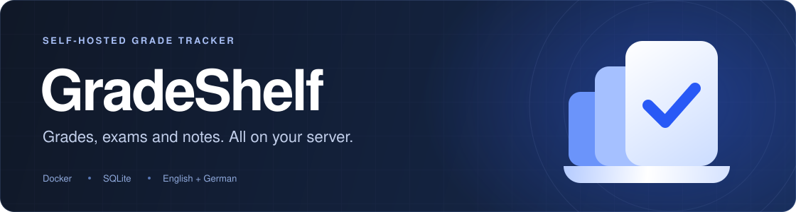
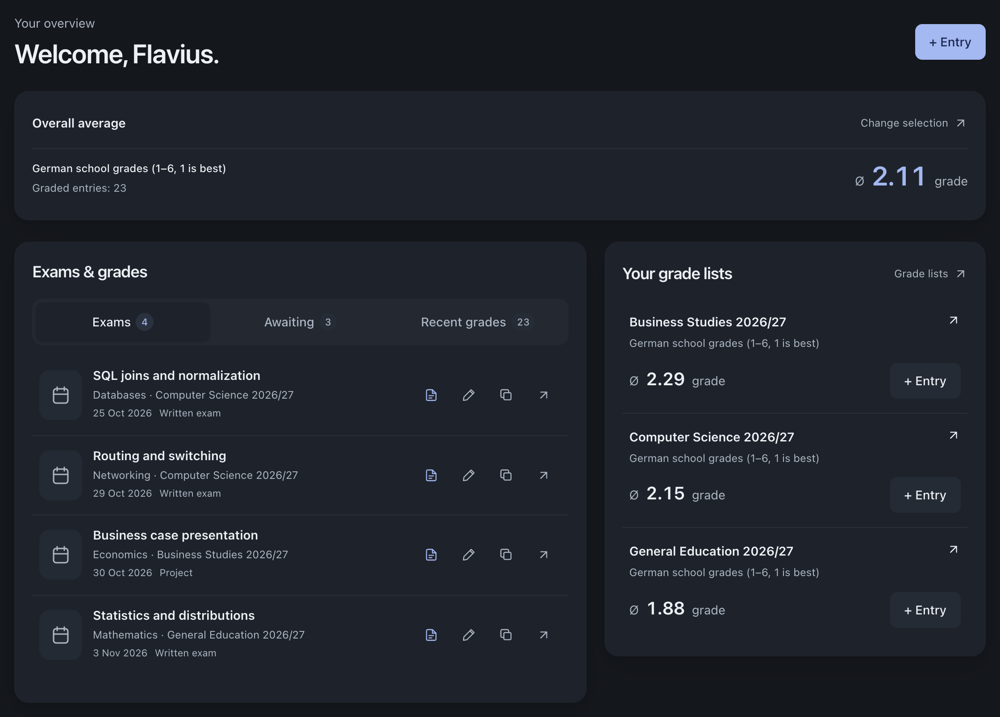
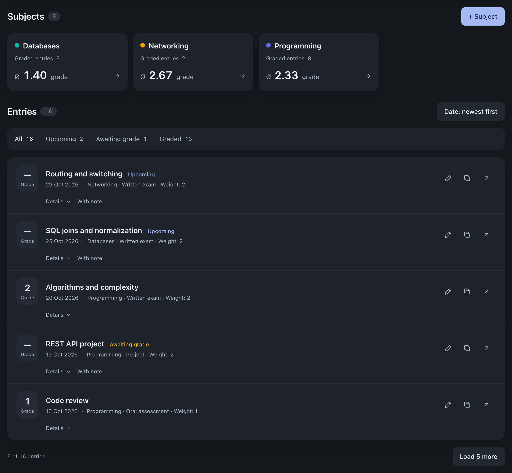

<p align="center">
  
</p>

<p align="center">
  <a href="#installation"><strong>Get started</strong></a> &nbsp;·&nbsp;
  <a href="#features">Features</a> &nbsp;·&nbsp;
  <a href="#updates-and-backups">Update &amp; back up</a> &nbsp;·&nbsp;
  <a href="#configuration">Configure</a> &nbsp;·&nbsp;
  <a href="https://gradeshelf.de">Website</a> &nbsp;·&nbsp;
  <a href="https://github.com/14flavius/GradeShelf/releases">Releases</a>
</p>

<p align="center"><sub>Private accounts &nbsp;·&nbsp; Light &amp; dark mode &nbsp;·&nbsp; Desktop &amp; mobile</sub></p>

<a name="preview"></a>
<p align="center">
  <a href=".github/screenshots/dashboard.png">
    
  </a>
</p>
<p align="center"><sub>Your overview, from upcoming exams to the latest results. Screenshots use example data.</sub></p>

<details>
<summary><strong>A closer look at a grade list</strong></summary>
<br>
<p align="center">
  <a href=".github/screenshots/grade-list.png">
    
  </a>
</p>

</details>

## Features

<table width="100%">
  <tr>
    <td width="50%" valign="top">
      <h3>Grades &amp; averages</h3>
      <p>Organize lists, subjects and grade types. Set weights, track averages and choose from nine grading scales.</p>
    </td>
    <td width="50%" valign="top">
      <h3>Exam planning</h3>
      <p>Plan upcoming exams, add results later and see which grades are still missing.</p>
    </td>
  </tr>
  <tr>
    <td width="50%" valign="top">
      <h3>Notes &amp; files</h3>
      <p>Keep notes and attachments with each entry. Export your data as a ZIP or a readable PDF report.</p>
    </td>
    <td width="50%" valign="top">
      <h3>Calendar subscription</h3>
      <p>Follow selected lists in Apple Calendar, Outlook or another ICS-compatible calendar.</p>
    </td>
  </tr>
  <tr>
    <td width="50%" valign="top">
      <h3>Private accounts</h3>
      <p>Share an instance with separate accounts, admin-managed roles and optional two-factor authentication.</p>
    </td>
    <td width="50%" valign="top">
      <h3>SSO login</h3>
      <p>Connect existing accounts to an OpenID Connect provider. Local sign-in remains available.</p>
    </td>
  </tr>
</table>

## Installation

Requires **Docker with Compose v2**, **curl** and **OpenSSL**. Docker images are
available for **amd64 and arm64**; no Node.js installation is needed on the host.

### 1. Install

Run the installer in a new directory:

```sh
mkdir -p gradeshelf
cd gradeshelf
curl -fSL --proto '=https' --proto-redir '=https' \
  https://raw.githubusercontent.com/14flavius/GradeShelf/main/scripts/install.sh \
  -o install.sh &&
sh install.sh
```

Follow the prompts for the instance name, browser URL, port and listen address.
Use the exact URL you will open in your browser, including `https://` behind a
reverse proxy. The installer creates the configuration and starts GradeShelf.
For an existing installation, follow [Updates and backups](#updates-and-backups).

### 2. Sign in

Open the URL you configured during installation.

| Username | Initial password |
| --- | --- |
| `gradeshelf` | `gradeshelf0000` |

> [!IMPORTANT]
> Change the initial password when prompted, before making the instance public.

Create accounts and manage roles in **Admin**. There is no public registration;
administrators cannot view another user's grades or files. Personal settings,
including two-factor authentication, are under **Settings**.

## Updates and backups

### Update

From your installation directory, back up and update:

```sh
sh scripts/backup.sh && docker compose pull && docker compose up -d --wait
```

Keep your existing `.env` and `data/` directory. Database migrations run
automatically on startup. If you pin an image version, update `GRADESHELF_IMAGE`
first. New images are available once the [release build](https://github.com/14flavius/GradeShelf/actions/workflows/docker-publish.yml) finishes.

### Back up

To create a backup without updating:

```sh
sh scripts/backup.sh
```

The backup briefly stops a running instance, saves its data and configuration to
`backups/`, then starts it again. Keep a protected copy outside the server.
The database and uploads live in `./data`; preserve this directory when replacing containers.

<details>
<summary><strong>Restore a backup</strong></summary>

Stop the app and restore a backup marked `COMPLETE` into a separate recovery directory:
copy `.env`, the full `data/` directory and the saved Compose file. Restore
`docker-compose.yml.backup` as `docker-compose.yml`.

Use the matching image version and ensure `data/` is writable by UID/GID `1000`.
Verify the restored installation before replacing the original. Downgrading the
Docker image alone does not undo database migrations.

</details>

## Configuration

Edit `.env` in your installation directory, then apply changes:

```sh
docker compose up -d --pull never --wait
```

| Setting | Purpose |
| --- | --- |
| `BETTER_AUTH_URL` | Full browser URL, such as `https://grades.example.com`. Subpaths are not supported. |
| `PORT` | Published HTTP port on the host, usually `3000`. |
| `BIND_ADDRESS` | `127.0.0.1` for local access or a proxy on the same host; `0.0.0.0` for LAN access. |
| `GRADESHELF_IMAGE` | Optional fixed image, e.g. `ghcr.io/14flavius/gradeshelf:1.2.0`. Defaults to `latest`. |

Keep the generated `BETTER_AUTH_SECRET` and `COMPOSE_PROJECT_NAME` unchanged.
For HTTPS, terminate TLS at your reverse proxy and forward to GradeShelf's HTTP
port. A proxy in another container needs network access to the app; its localhost
is separate from the host's.

Change the display name, legal notice and administrator contact in
**Admin → Instance settings**. See [`.env.example`](.env.example) and
[`docker-compose.yml`](docker-compose.yml) for all deployment options.

### Connect SSO

1. Register a confidential OIDC client with your provider using **Authorization
   Code with PKCE (S256)** and scopes `openid profile email`. Use
   `client_secret_basic` or `client_secret_post` and ensure an email address is supplied.
2. In **Admin → Advanced features → SSO login**, enter the exact issuer URL,
   client ID and client secret. Register the displayed callback URL with your
   provider, check the configuration, then enable SSO and save.
3. Sign in locally and connect your account under **Settings → Security → SSO
   login**. Use **Confirm local sign-in** if prompted. Future visits can use the
   **SSO login** button.

Use HTTPS and make sure the provider is reachable from both GradeShelf and your
browser. SSO connects existing accounts; it does not create users or synchronize roles.
Keep a local administrator login available and configure SSO two-factor
authentication at the provider.

Saving SSO settings ends existing SSO sessions. If the issuer or client ID changes,
users must reconnect their accounts. Signing out of GradeShelf does not sign out
of the provider. To block access immediately, deactivate the account in GradeShelf;
a provider-only suspension does not end existing GradeShelf sessions.

<details>
<summary><strong>Upload limits</strong></summary>

Add these optional settings to `.env` and ensure they are passed through in your
[`docker-compose.yml`](docker-compose.yml):

| Setting | Default | Allowed values |
| --- | --- | --- |
| `UPLOAD_MAX_FILE_MB` | `10` | 1–100 MiB per file |
| `UPLOAD_MAX_FILES_PER_ENTRY` | `10` | 1–100 files per entry |
| `UPLOAD_MAX_USER_GB` | `0` (unlimited) | 0–1024 GiB of attachments per user; decimals allowed |

Lowering a limit does not delete existing files.

</details>

<details>
<summary><strong>Multiple instances</strong></summary>

Use a separate directory, Compose project name and host port for each instance.
Use separate hostnames for independent browser logins; cookies are shared across
ports on the same hostname. Run one app instance per database on local disk.

</details>

## Help

Questions or problems? [Open an issue](https://github.com/14flavius/GradeShelf/issues).
For startup problems, check `docker compose logs --tail=100` and
`docker compose ps`. Remove secrets and personal information before sharing logs.

To create an additional administrator from the terminal:

```sh
docker compose exec gradeshelf npm run admin:create
```

## Development

<details>
<summary><strong>Run locally and check your changes</strong></summary>

Use **Node.js 24.11+ within the Node 24 release line**. The app uses Next.js,
TypeScript, Tailwind, Better Auth and Prisma.

```sh
git clone https://github.com/14flavius/GradeShelf.git gradeshelf
cd gradeshelf
sh scripts/setup.sh
npm ci
npm run db:generate
npm run db:init
npm run dev -- --hostname 127.0.0.1
```

Checks: `npm run lint`, `npm run format:check`, `npm run typecheck`,
`npm run db:validate`, `npm run build`. On existing databases, apply migrations
with `npm run db:deploy`; never reset them.

</details>

---

<p align="center">
  <a href="#installation">Install GradeShelf</a> &nbsp;·&nbsp;
  <a href="https://github.com/14flavius/GradeShelf/issues">Get help</a> &nbsp;·&nbsp;
  <a href="https://gradeshelf.de">Visit the website</a>
</p>
<p align="center">
  By <a href="https://flavius-hager.de">Flavius Hager</a><br>
  <sub>Most of the original GradeShelf foundation was vibe-coded with AI assistance.</sub>
</p>
