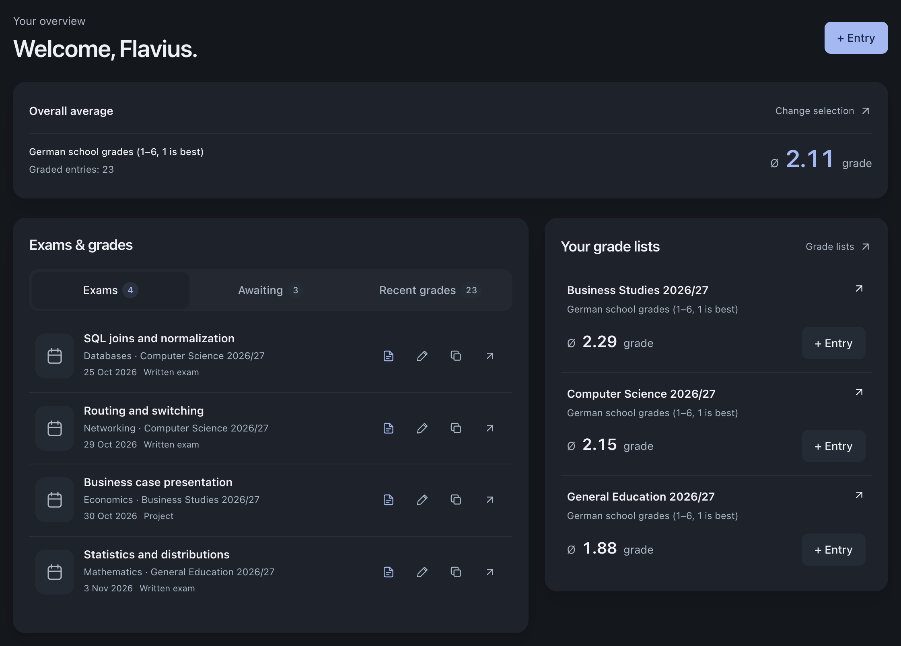
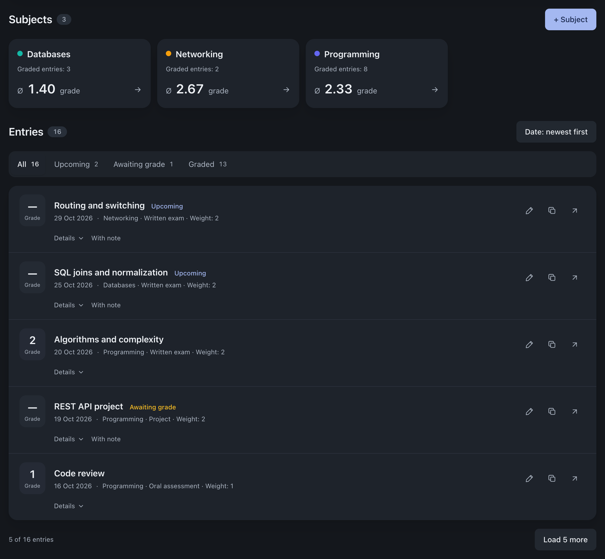

<p align="center">
  
</p>
<h1 align="center">GradeShelf</h1>
<p align="center"><strong>A self-hosted grade tracker and exam planner.</strong><br>One place for your grades. Separate accounts for everyone.</p>
<p align="center">
  Multi-user · Docker · English &amp; German · v1.1.0
</p>
<p align="center">
  <a href="#features">Features</a> ·
  <a href="#preview">Preview</a> ·
  <a href="#installation">Install</a> ·
  <a href="#configuration">Configure</a> ·
  <a href="#updates-and-backups">Update &amp; back up</a> ·
  <a href="https://gradeshelf.de">Website</a> ·
  <a href="https://github.gradeshelf.de">GitHub</a>
</p>

GradeShelf is a **self-hosted, multi-user grade management app** for tracking
subjects, weighted averages and upcoming exams. Organize each school year or course
in its own grade list, record results and see which exams still need a grade.

Run it for yourself or share an instance: **each user has their own private lists,
notes and files**. Administrators manage accounts without access to other users'
grades. Deploy with Docker Compose; everything stays on your server, with no cloud
account or telemetry.

## Preview

<table>
  <tr>
    <td width="50%" valign="top" align="center">
      <strong>Your dashboard</strong><br>
      <sub>Averages, upcoming exams and grades to follow up on.</sub><br><br>
      <a href=".github/screenshots/dashboard.png">
        
      </a>
    </td>
    <td width="50%" valign="top" align="center">
      <strong>Inside a grade list</strong><br>
      <sub>Subjects, results and exams in one view.</sub><br><br>
      <a href=".github/screenshots/grade-list.png">
        
      </a>
    </td>
  </tr>
</table>

<p align="center"><sub>Example data · Click a preview to explore the full screenshot.</sub></p>

## Features

| | What you can do |
| --- | --- |
| **Grade tracking** | Create multiple lists, organize subjects and reuse grade types with custom weights. Archive completed years. |
| **Weighted averages** | See subject, list and overall averages, plus recent trends. Choose from nine grading scales. |
| **Calendar subscription** | Subscribe to selected grade lists in Apple Calendar, Outlook or other ICS-compatible calendars. Customize event titles and descriptions. |
| **Exam planning** | Add an exam now, enter its grade later. Keep upcoming exams and missing results in view. |
| **Multiple users** | Share one installation with separate accounts and private data. Admins create and manage users. |
| **Notes & files** | Keep notes and attachments with each entry. Export your data as a ZIP or a readable PDF report. |
| **Your workspace** | English or German, light or dark mode, a configurable dashboard and layouts for phones, tablets and desktops. |

**Local by design:** one container, SQLite and a persistent data directory. Optional
TOTP two-factor authentication with recovery codes; no public registration.

<details>
<summary>Supported grading scales and attachments</summary>

**Grading scales:** German school grades (1–6), upper-secondary points (0–15),
US letter grades (A+–F), percentages, and numeric scales of 1–5, 1–6, 0–10, 0–20 and 0–4.

Averages use `Σ(grade × weight) / Σ(weight)`; US letters use their assigned grade
points. Ungraded entries are excluded and different scales stay separate.
Trends use a rolling window of up to ten grades.

**Attachments:** PDF, JPEG, PNG, WEBP and HEIC/HEIF; by default, up to 10 MiB per file
and ten files per entry. Operators can change these limits and set a storage quota
per user. Downloads require the owning user's login.

</details>

## Installation

Requires **Docker with Compose v2**, **curl** and **OpenSSL**. Docker must be running.
No source checkout or Node.js installation is needed.

```sh
mkdir -p gradeshelf
cd gradeshelf
curl -fSL --proto '=https' --proto-redir '=https' \
  https://raw.githubusercontent.com/14flavius/GradeShelf/main/scripts/install.sh \
  -o install.sh &&
sh install.sh
```

The installer creates `.env`, generates a secret, prepares `./data` and starts
`ghcr.io/14flavius/gradeshelf:latest`. Images support amd64 and arm64.

| Installer prompt | What to enter |
| --- | --- |
| Instance name | A unique Docker Compose project name, e.g. `gradeshelf`. |
| Browser URL | The address you will open: `http://localhost:3000`, a LAN address, or your full public `https://` URL. |
| Host port | `3000`, or another free port. |
| Listen address | `127.0.0.1` for local access or a reverse proxy on the same host; `0.0.0.0` for LAN access. |

Use the installer for new installations only. To change an existing installation,
edit its configuration or use the update command below. If startup fails, inspect
`docker compose logs --tail=100`, fix the issue, then retry `docker compose up -d --wait`.

### First login

Open your configured URL and sign in:

| Username | Initial password |
| --- | --- |
| `gradeshelf` | `gradeshelf0000` |

Change the password when prompted **before exposing the instance publicly**.
The tutorial helps you create your first list, subjects and grade types.

Add users in **Admin**. There is no public registration or email password reset.
Admins can reset passwords and 2FA, but cannot view another user's grades or files.
To create an additional administrator from the terminal:

```sh
docker compose exec gradeshelf npm run admin:create
```

## Configuration

Edit `.env` in the installation directory, then apply the changes:

```sh
nano .env
docker compose up -d --pull never --wait
```

| Variable | Purpose |
| --- | --- |
| `BETTER_AUTH_SECRET` | Generated by setup. Keep it unchanged across updates and restores; it also protects 2FA data. |
| `BETTER_AUTH_URL` | Exact browser URL, including the scheme. No subpath. |
| `PORT` | Published host port; default `3000`. |
| `BIND_ADDRESS` | Host interface; default `127.0.0.1`. |
| `COMPOSE_PROJECT_NAME` | Docker instance name. Keep it unchanged after installation. |
| `GRADESHELF_IMAGE` | Optional image override, e.g. `ghcr.io/14flavius/gradeshelf:1.1.0` to pin a release. Defaults to `latest`. |
| `DATA_DIR` | Local Node.js development only. Compose always mounts `./data` at `/data`. |

Full configuration: [`.env.example`](.env.example) · [`docker-compose.yml`](docker-compose.yml)

**Public HTTPS domain**, with a reverse proxy running directly on the host:

```dotenv
BETTER_AUTH_URL=https://grades.example.com
BIND_ADDRESS=127.0.0.1
PORT=3000
```

Forward the proxy to `http://127.0.0.1:3000`. GradeShelf serves HTTP only; configure
HTTPS in your own reverse proxy. A proxy in another container needs Docker network
access to the app — its localhost is not the host's localhost.

**Direct LAN access:**

```dotenv
BETTER_AUTH_URL=http://192.168.1.20:3000
BIND_ADDRESS=0.0.0.0
PORT=3000
```

Replace the IP with your server's address. Keep using the configured browser URL;
`localhost` and `127.0.0.1` are different origins.

**Multiple instances:** use a separate directory, Compose project name and host port
for each installation. For simultaneous browser logins, use separate hostnames;
cookies are shared across ports on the same hostname.

The public display name, legal notice and administrator contact can be changed in
**Admin → Instance settings**. The display name is independent of the Docker project name.

### Optional upload limits

These settings are not part of the installer prompts. Add them to `.env` if you
want different limits; the same settings apply to every user, including admins.

| Variable | Default | Allowed values |
| --- | --- | --- |
| `UPLOAD_MAX_FILE_MB` | `10` | Maximum size per file in MiB; whole numbers from `1` to `100`. |
| `UPLOAD_MAX_FILES_PER_ENTRY` | `10` | Maximum attachments per entry; whole numbers from `1` to `100`. |
| `UPLOAD_MAX_USER_GB` | `0` (unlimited) | Total attachment storage per user in GiB, from `0` to `1024`. Decimals such as `0.5` are supported. |

For example, allow 20 MiB per file, five attachments per entry and 2 GiB per user:

```dotenv
UPLOAD_MAX_FILE_MB=20
UPLOAD_MAX_FILES_PER_ENTRY=5
UPLOAD_MAX_USER_GB=2
```

Apply with `docker compose up -d --pull never --wait`; no image rebuild is needed.
Existing installations also need the three environment entries from the current
[`docker-compose.yml`](docker-compose.yml) in their Compose service.

Users see their storage usage in **Settings** and when attaching files. A warning
appears at **80%**; uploads that exceed the quota are rejected. Archived attachments
count, while grades, notes and backups do not. Lowering a limit never deletes data
or prevents existing downloads. Deleting an attachment frees its quota.

The `_MB` and `_GB` names use binary units: 1 MiB = 1,048,576 bytes and 1 GiB =
1,073,741,824 bytes. This is an attachment quota, not a reservation of disk space.
Larger uploads use more memory; set limits to suit your server and reverse proxy.

## Updates and backups

Run these commands from the installation directory.

**Back up and update:**

```sh
sh scripts/backup.sh && docker compose pull && docker compose up -d --wait
```

`latest` follows the latest stable release after its image build completes.
Updates apply pending database migrations. Keep the existing `.env` and `./data`.
If you pinned an image version, change `GRADESHELF_IMAGE` before updating.

**Back up without updating:**

```sh
sh scripts/backup.sh
```

The script briefly stops a running app, copies the database, uploads, `.env`, Compose
configuration and image ID into `backups/`, then restarts it. A `COMPLETE` file marks
a successful backup. Keep a protected copy outside the server. User ZIP exports do
not replace a full backup.

**Restore:** stop the app, restore the backed-up `.env`, Compose configuration and
complete data directory into a separate recovery directory. Use the matching image
version and make the data directory writable by UID/GID `1000`. Verify the restored
installation before removing the original. Using an older image alone does not undo migrations.

### Where data lives

```text
gradeshelf/
├── docker-compose.yml
├── .env
├── data/
│   ├── gradeshelf.db
│   └── uploads/
├── scripts/
│   ├── backup.sh
│   └── prepare-data.sh
└── backups/                   # Created by the backup script
```

`./data` is mounted at `/data` in the container. Stops, restarts, image replacement
and `docker compose down` retain it. Deleting the host directory still deletes the
data; the mount is not a backup. Run one app instance per database, on local disk.

```sh
docker compose ps                 # Status and health
docker compose logs --tail=100     # Recent logs
docker compose stop               # Stop, retain data
docker compose start              # Start the existing container
docker compose restart gradeshelf # Restart without updating
```

## Development

Stack: Next.js, TypeScript, Tailwind CSS, Better Auth, Prisma and SQLite.
Use **Node.js 24.11+ within the Node 24 release line**.

```sh
git clone https://github.com/14flavius/GradeShelf.git gradeshelf
cd gradeshelf
sh scripts/setup.sh
npm ci
npm run db:generate
npm run db:init
npm run dev -- --hostname 127.0.0.1
```

Checks: `npm run lint`, `npm run format:check`, `npm run typecheck`,
`npm run db:validate`, `npm run build`. Apply migrations to an existing database
with `npm run db:deploy`; never reset it. [Schema](prisma/schema.prisma).

The [release workflow](.github/workflows/docker-publish.yml) builds and publishes
Docker images when a stable GitHub release is published. Its `vX.Y.Z` tag must match
`package.json` and `package-lock.json`. The GHCR package must be public for anonymous pulls.

---

<p align="center">
  By <a href="https://flavius-hager.de">Flavius Hager</a><br>
  <sub>Most of the original GradeShelf foundation was vibe-coded with AI assistance.</sub>
</p>
